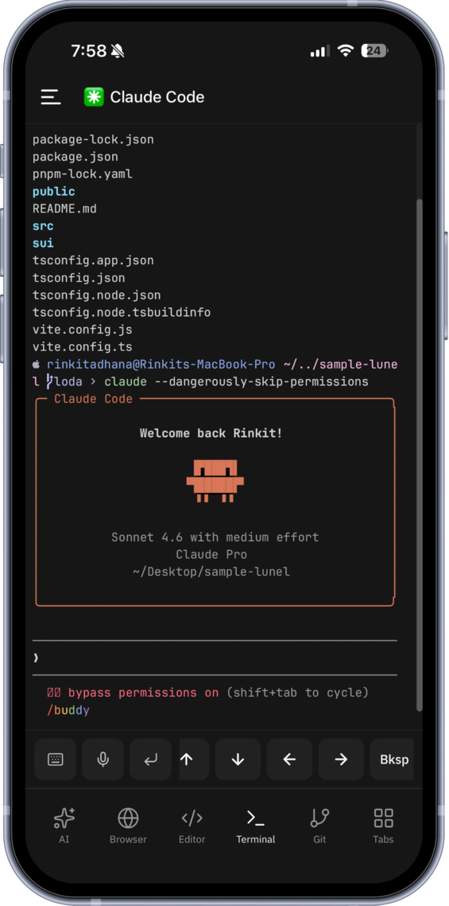
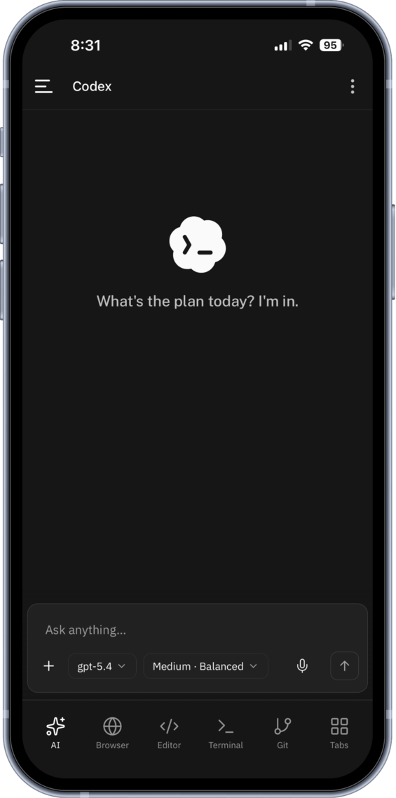
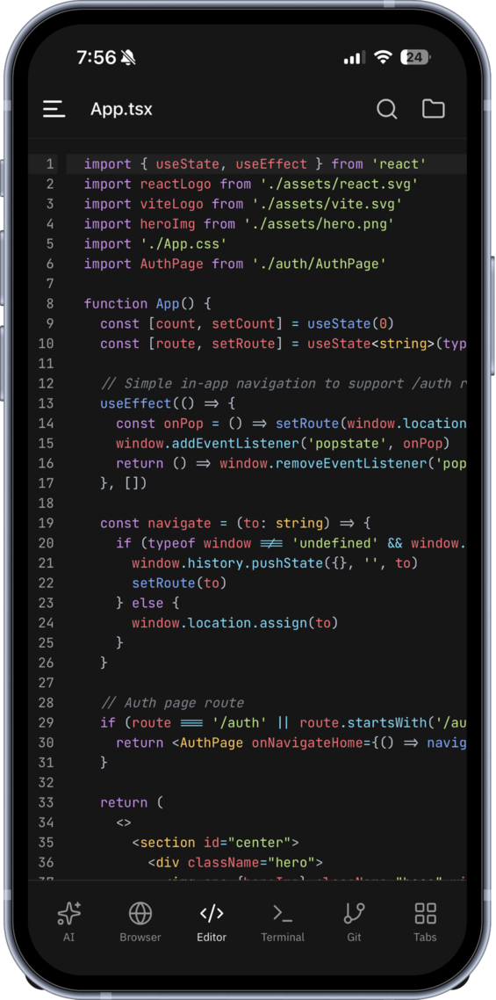

<div align="center">
  <a href="https://helixbox.vercel.app/">
    
  </a>
</div><br />
<p align="center"><strong>Build, run, and ship directly from your phone.</strong></p>
<p align="center">HelixBox connects your phone to your laptop's development environment: files, terminal, Git, app previews and AI coding agents.</p>

<p align="center">
  <a href="https://helixbox.vercel.app/"></a>
  &nbsp;•&nbsp;
  <a href="https://github.com/devndesigner6/helix-box-solana/releases/tag/v1-solana-beta.1"></a>
  &nbsp;•&nbsp;
  <a href="https://github.com/devndesigner6/helix-box-solana"></a>
</p>

## Demo

[](https://youtu.be/KXF1TQKWFDM)

[Watch the walkthrough on YouTube](https://youtu.be/KXF1TQKWFDM): laptop pairing, the mobile workspace and bounded agent model purchases using USDC on Solana.

<p align="center">
  
  &nbsp;&nbsp;
  
  &nbsp;&nbsp;
  
</p>

## Structure

| Directory | Description |
|-----------|-------------|
| `app/` | Expo/React Native mobile app |
| `cli/` | CLI tool (`helixbox-cli`) |
| `manager/` | Manager server |
| `proxy/` | Proxy server |
| `pty/` | Rust PTY binary uses wezterm internal libs for rendering |
| `landing/` | Current product website, built from Vite source |
| `docs/` | HelixBox handbook |

<br />

## Quick Start

1. Start HelixBox in your project directory:

```bash
npx helixbox-cli
```

2. Install the [Android APK](https://github.com/devndesigner6/helix-box-solana/releases/download/v1-solana-beta.1/HelixBox-Solana.apk), then scan the pairing QR code.
3. Resume your workspace to access its files, terminal, Git state, processes, and available AI agents.

For an existing connection, resume from app launch or **Past Sessions**. A valid saved session returns to the same workspace; the laptop CLI must still be running and reachable. Use `npx helixbox-cli --new` when you intentionally want a fresh pairing QR code.

<br /> 

## App

Expo/React Native mobile app, currently distributed on Android. iOS and web are development targets, not published releases. The CLI performs workspace operations while the app provides a mobile control surface for the connected environment.

- File explorer and editor
- Git integration
- Terminal emulator
- Process management
- Running-app browser with DevTools
- Built-in API client for sending requests and inspecting responses
- Ports manager and live resource monitoring
- Text tools for encoding, decoding, formatting and hashing
- AI agent sessions with Codex, OpenCode, Claude Code, and Hermes, including voice input
- Optional Brainrot mode for switching to entertainment while an agent works

### Supported Languages (22)

`en`, `zh`, `ja`, `ko`, `es`, `pt`, `de`, `fr`, `vi`, `ru`, `id`, `pl`, `tr`, `it`, `nl`, `sv`, `uk`, `fi`, `zh-TW`, `tw`, `ms`, `es-MX`

<br />

## CLI

Node.js CLI that securely connects your local workspace to the app over WebSocket. Run it with `npx helixbox-cli`.

- Filesystem operations (read, write, grep, etc.)
- Git commands (status, commit, push, pull, etc.)
- Terminal spawning
- Process management
- Port scanning
- System monitoring (CPU, memory, disk, battery)

```bash
npx helixbox-cli
```

<br />

## x402 Model Tools

Pairing, workspace tools and access to coding agents installed on your laptop are free. The agents use their own provider authentication; their subscriptions and API charges remain separate.

When a task needs another model, Codex or Claude Code can discover it, request a quote and buy the result through x402 on Solana. Model tools include live chat, image and speech catalogs. A catalog entry must pass availability and bounded-pricing checks before it can be purchased.

Open **AI menu → Model tools** or **Settings → Wallet → Open model tools**:

1. Connect MetaMask and choose the models your agent may use.
2. Set a total budget, per-call cap, maximum calls and expiry.
3. Approve the first quoted call and bounded USDC channel deposit in MetaMask.
4. Keep the phone foregrounded. A separate phone-held key signs subsequent calls within your limits, without another wallet approval for every request.

The provider key stays on the backend, and your wallet's private key is never given to the coding agent. A complete result is prepared and encrypted before its charge is accepted. The result is released after payment acknowledgement; cumulative channel usage is redeemed and paid out on-chain in batches. A completed call and an on-chain payout are separate steps.

| Access | Price |
|--------|-------|
| Workspace and installed coding agents | Free HelixBox access; provider charges remain separate |
| Optional model calls | Quoted per bounded request, from 0.001 to 1 USDC |

Quotes expire after two minutes and include a 20% service margin. Chat calls have prompt and output limits. Images require bounded per-image pricing and supported PNG output; speech requires bounded text pricing. Calls without a verified price bound are declined.

**Network:** Solana Mainnet<br>
**Settlement asset:** USDC<br>
**Mainnet `payTo`:** `7sbe2WLBQxJCBmPfL2xsy7WiFzjMS147R1DUK7LHwxyy`

MetaMask signs the funding transaction in the wallet app. There is no checkout website and no request for your recovery phrase. The app validates the network, asset, recipient, amount and purchase identity before signing.

Purchases use durable identities, ownership checks, encrypted input/results, unique transaction fingerprints and settlement receipts. A completed call is retrieved rather than executed again. Uncertain settlement or provider execution is held for reconciliation, not automatically retried. Prompts/results expire after 24 hours; receipt metadata is retained.

**Payment beta:** start with a small budget. Real Android/mainnet model purchases have been exercised; the demo is linked above. Mandates apply across the paired workspace, not per chat. Keep the phone-held signing key on the device and the app foregrounded for new authorizations. Stop blocks new purchases; returning unused escrow requires the channel-close/refund flow. It does not refund previously charged purchases. See the [implementation ledger](tasks/model-tools-progress.md) for checks and remaining work.

The built-in manual API client stays free.

<br />

## Manager and Proxy

Bun-based WebSocket service that connects the CLI and app using session codes. The public manager is deployed at [helixbox-manager.onrender.com](https://helixbox-manager.onrender.com).

Use [manager/.env.example](manager/.env.example) for network, USDC, receiving-address and facilitator settings. Workspace sessions use SQLite; model purchases, mandates, channels and hashed ownership credentials use the private Neon `DATABASE_URL`. Payment storage must be durable. No server-side payer wallet private key is required.

Model tools need a funded backend-only `OPENROUTER_API_KEY` and a stable `MODEL_DATA_KEY` of at least 32 characters. Back up the data key: it encrypts retained results and derives the merchant's channel-close authorizer. Keep admin credentials, provider keys and `DATABASE_URL` out of `EXPO_PUBLIC_*`, agent prompts and Git. For self-hosting, keep `MODEL_ENABLE_PAYMENTS=false` until storage, configuration and payment checks pass.

Read the [model-tools design](docs/MODEL_CATALOG_DESIGN.md) and [handbook](docs/HANDBOOK.md) for configuration, recovery and deployment details.

Use CLI **0.2.0 or newer** for agent model tools. The CLI exposes catalog, mandate, quote, purchase and status tools to Codex and Claude Code. Image/audio results are saved under `.helixbox-model-results/` in the project. For CLI development, run `npm ci` and `npm run build` in `cli/`.

- Pairing codes with a seven-day lifetime, separate from model purchase identity
- Dual-channel architecture (control + data)
- QR code pairing

<br />

## PTY

Rust binary for pseudo-terminal management, used by the CLI.

- Real PTY sessions via `wezterm` fork on github.com/sohzm/wezterm
- Screen buffer as cell grid (char + fg + bg per cell)
- 24fps render loop (only sends updates when content changes)
- JSON line protocol over stdin/stdout

<br />

## AI Agent Integration

HelixBox supports Codex, OpenCode, Claude Code, and Hermes when their CLIs are installed and authenticated in the paired laptop environment. Availability comes from the CLI's detected status, not a static list. Codex and GPT-5.6 also assisted with several parts of the implementation:
- **Rust PTY Delta Engine**: Codex co-authored the optimized incremental screen buffer diffing logic in the Rust PTY rendering loop, ensuring low-latency communication over standard output.
- **WebSocket Reconnection Logic**: GPT-5.6 helped design the network reconnection state machine in the Bun WebSocket proxy to maintain active connection states during mobile cellular handoffs.
- **Protocol Typings**: Codex generated TypeScript definitions for the control-plane RPC protocol to ensure type safety between the mobile app and the local CLI bridge.

<br />

## Handbook

Read the [HelixBox handbook](docs/HANDBOOK.md) for setup, workspace tools, agents, payments, development, Android builds and troubleshooting.

To build an Android APK in Expo's cloud, run from the repository root:

```cmd
cd app
npm ci --legacy-peer-deps
npx eas-cli build --platform android --profile preview
```

Set the public manager and proxy URLs in EAS using [app/.env.example](app/.env.example). OTA updates are disabled unless a Solana-only update endpoint is explicitly configured. Native builds and wallet flows need device testing separately from JavaScript export checks.

<br />

## 📄 License

MIT: See [LICENSE](LICENSE) for details.

<br />

## Star History

<a href="https://www.star-history.com/#devndesigner6/helix-box-solana&Timeline">
 <picture>
   <source media="(prefers-color-scheme: dark)" srcset="https://api.star-history.com/svg?repos=devndesigner6/helix-box-solana&type=Timeline&theme=dark" />
   <source media="(prefers-color-scheme: light)" srcset="https://api.star-history.com/svg?repos=devndesigner6/helix-box-solana&type=Timeline" />
   
 </picture>
</a>
